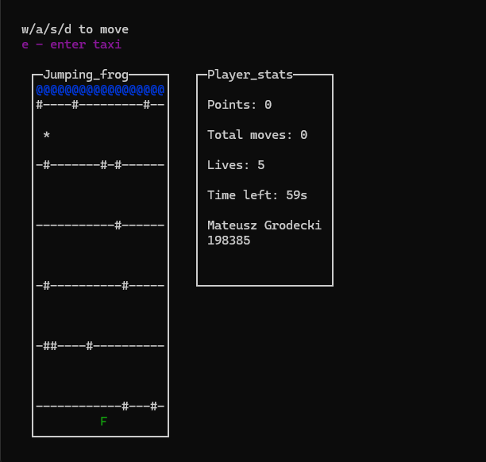

# Jumping Frog 🐸

A terminal-based arcade game inspired by the classic Frogger, developed in C++ using the ncurses library. Cross busy roads, avoid obstacles, and reach the other side to score points.



## Features

- Moving vehicles with different speeds and directions
- Collision detection, obstacles, and a moving stork
- Friendly vehicles with a taxi mechanic
- Scoring system, lives, and local leaderboard
- Customizable game settings through `frogconfig.txt`

## Build & Run

**Requirements:** Linux (tested on Ubuntu/WSL), G++, GNU Make, and ncurses.

Install dependencies on Ubuntu:

```bash
sudo apt update
sudo apt install build-essential libncurses-dev
```

Clone and run:

```bash
git clone https://github.com/Grodek17/Jumping_Frog.git
cd Jumping_Frog
make
./frogger
```

## Controls

| Key | Action |
|---|---|
| W / A / S / D | Move the frog |
| E | Enter a friendly vehicle when nearby |
| K | Exit after game over |

## About

Originally developed as a university C++ programming project, focusing on game logic, data structures, pointers, and file handling. The original implementation has been largely preserved, while the repository structure, build process, and documentation have been improved.